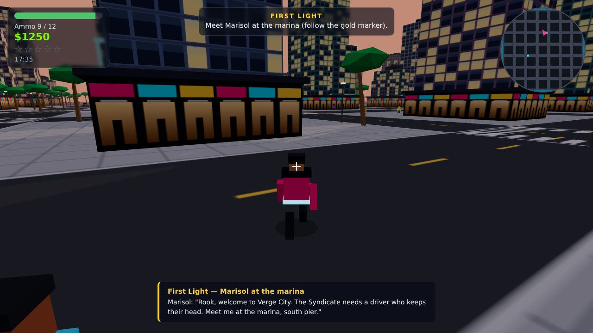
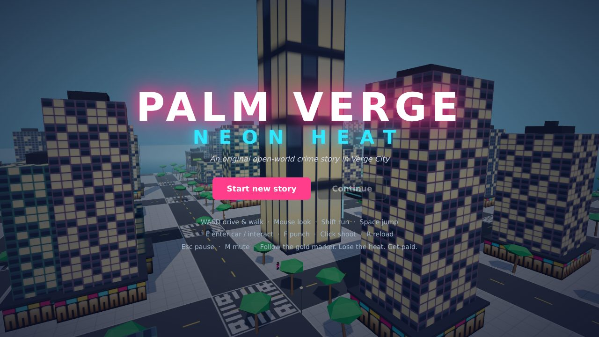
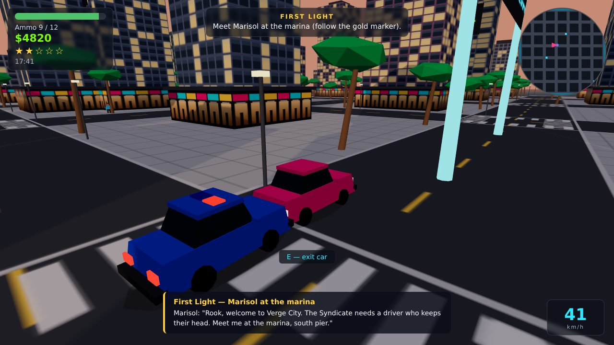
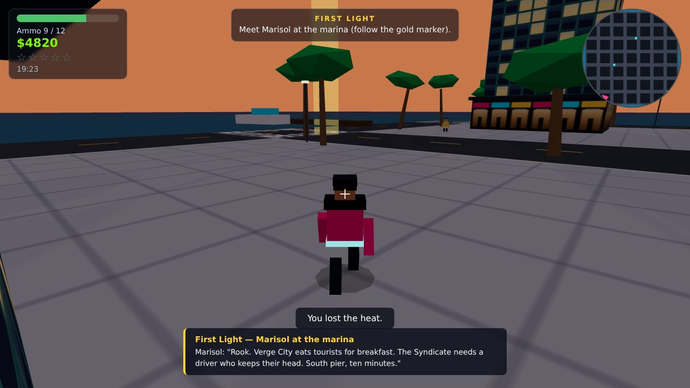

# Palm Verge — Neon Heat

An original open-world crime game that runs in the browser. Verge City is a
procedurally generated neon island: a 7×7 street grid of towers, palms and
shopfronts, a landmark tower, a marina, and a neon arch over the main avenue.
You play Rook, a new wheelman for the Neon Syndicate, working a six-job story
from a first meeting at the marina to an armoured-truck score.

Runs offline in desktop Chrome. No network requests, no external assets, no
build step, and no third-party game code — just Three.js and the game.



## Play

```bash
node serve.ts            # then open http://127.0.0.1:8080
```

Or open `game/index.html` over any static file server. The game needs no
build. Opening `game/index.html` directly from the filesystem will not work
because ES modules require an HTTP origin.

## Controls

| Input | On foot | In a car |
| --- | --- | --- |
| `W` `A` `S` `D` | Walk (camera relative) | Throttle / brake / steer |
| `Shift` | Sprint | — |
| `Space` | Jump | — |
| `E` | Enter a car, use a shop, interact | Exit the car |
| `F` | Punch | — |
| Left click | Shoot | — |
| `R` | Reload | — |
| Mouse | Look | Look |
| `Esc` | Pause | Pause |
| `M` | Mute | Mute |

Follow the gold column of light: it marks your current objective. The cyan
column marks the car a job wants you to steal.

## What is in it

- **City** — 49 blocks generated from a fixed seed: towers with tiled facades,
  street-level shopfronts, rooftop clutter, neon signs, palms, lamp posts, a
  landmark tower with a spinning crown, a marina with docks and boats, and a
  neon arch over the main avenue.
- **On foot** — walk, sprint, jump, punches, a hitscan pistol with a magazine
  and reload, health with slow regeneration, and damage feedback.
- **Driving** — arcade handling with speed-sensitive steering, braking, body
  damage and repair. Cars are stealable from the street, and a carjacked
  driver raises your wanted level.
- **Traffic and crowds** — cars keep to the right-hand lane of the grid, turn
  at intersections and avoid what is in front of them; pedestrians stroll the
  blocks and flee gunfire and speeding cars.
- **Police and heat** — a five-star wanted level spawns cruisers that chase,
  ram and shoot. Heat decays once you break line of sight long enough.
- **Story** — six jobs: a first meeting, a car theft and delivery, a timed
  package run, an escape from the police, a firefight with four rivals, and a
  final armoured-truck score. Jobs pay cash and unlock the next; finishing the
  story opens free roam.
- **Systems** — a HUD with health, cash, wanted stars and clock; a live
  minimap with the objective marker, shops and police; briefings, toasts and
  end screens; ammo, health and repair shops; save and continue through
  `localStorage`.
- **Presentation** — a day/night cycle with golden-hour warmth, real shadow
  mapping, neon emissives, an original Web Audio synthesizer soundtrack and
  sound effects, and a title screen that orbits the landmark tower.

## Screenshots

| Title | On foot | Driving | Story |
| --- | --- | --- | --- |
|  |  |  |  |

Screenshots are genuine renders of the game, captured headlessly from the
game's own screenshot staging (`?shot=…`), which is also how the competition
build is captured deterministically.

## Layout

```
main.ts                  competition entrypoint: publishes game/ + screenshots/
vendor/makefun-game.ts   make.fun library, unchanged from the official kit
game/index.html          page, HUD and menu styling
game/src/                the game (see below)
game/vendor/             Three.js r170, vendored for offline use
screenshots/             captured renders
tests/                   headless browser tests (see Testing)
serve.ts                 zero-dependency static server for local play
```

`game/src` modules:

| File | Role |
| --- | --- |
| `main.js` | boot, fixed-step loop, camera, police, combat, missions, day/night |
| `city.js` | procedural city, textures, colliders, collision resolution |
| `vehicles.js` | car models, arcade handling, traffic AI |
| `actors.js` | character models, pedestrians, rival gunmen |
| `missions.js` | the six-job story state machine |
| `hud.js` | DOM HUD, minimap, menus, briefings |
| `input.js` | keyboard, mouse and pointer lock |
| `audio.js` | Web Audio synth soundtrack and effects |
| `save.js` | `localStorage` save and load |
| `config.js` | tuning constants, palette, save key |
| `random.js` | seeded RNG (mulberry32) |
| `shots.js` | deterministic screenshot staging (`?shot=`) |

Everything that varies is drawn from one seeded stream, so the same seed
builds the same city and the same screenshot.

## Determinism

The competition build must produce identical bytes on repeated runs.
`main.ts` copies the game and the screenshots and writes a dossier through the
official library; the screenshots come from `?shot=start|play|drive|mission`,
each staged with a fixed seed, a fixed clock, a fixed number of simulation
steps and two painted frames before capture.

## Testing

The game exposes a headless QA hook behind `?test=1`, which drives the real
simulation (no GPU needed) so missions, police, combat and saving can be
checked automatically.

```bash
npm i puppeteer-core @sparticuz/chromium   # or use a local Chrome
node tests/gameplay.test.mjs              # movement, cars, police, combat, save
node tests/story.test.mjs                 # all six missions to story complete
node tests/screenshots.mjs                # re-capture screenshots/
```

The browser tests start `serve.ts` themselves and exit non-zero on failure.
Chromium's shared libraries must be available; the test scripts honour
`LD_LIBRARY_PATH` for a bundled build.

## Originality

Palm Verge is original work. The city, characters, story, code, textures,
soundtrack and sound effects are generated or written for this project. No
Grand Theft Auto assets, characters, trademarks, maps, music or code are used;
there is no affiliation with Rockstar Games. Three.js is used under the MIT
license (`game/vendor/THREE-LICENSE.txt`).

## License

MIT — see `LICENSE`.
